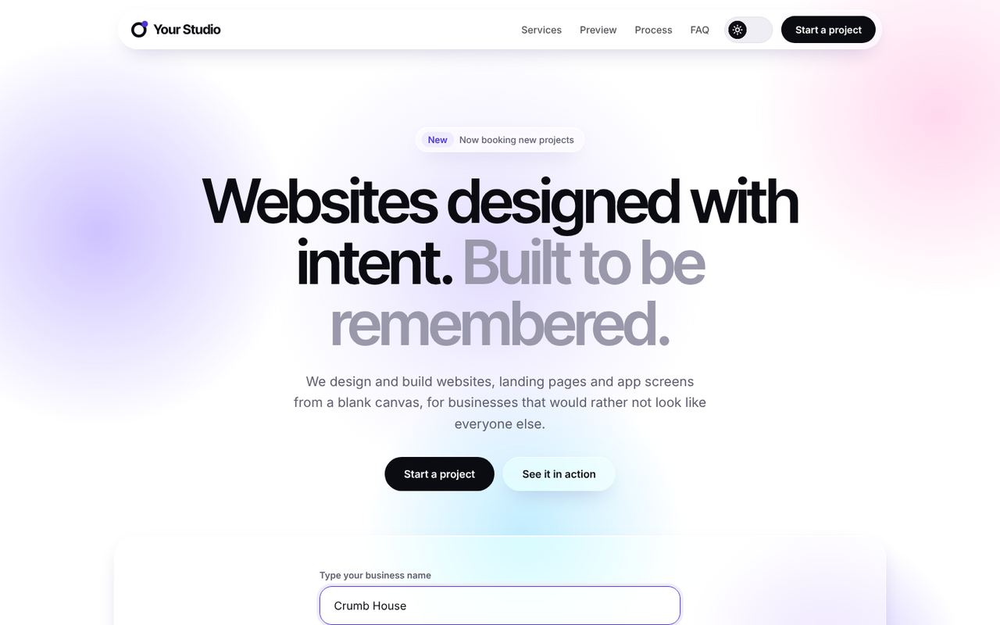
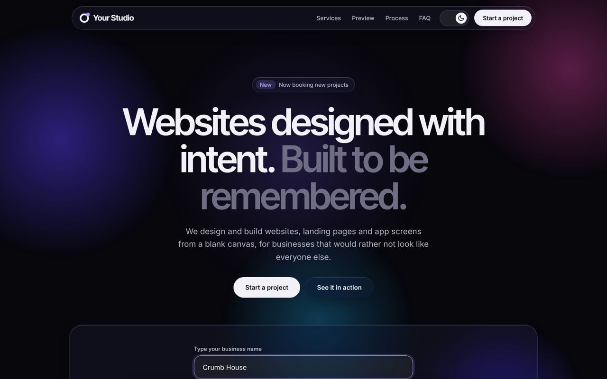
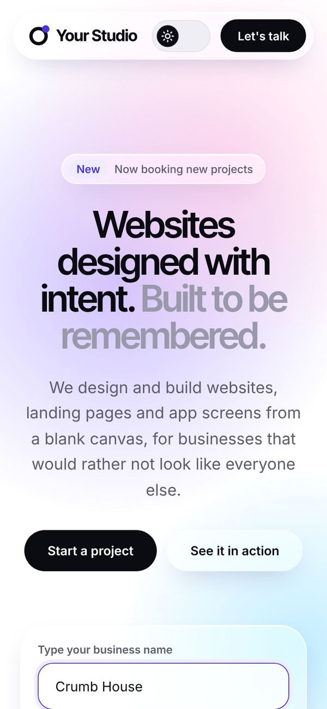

# Liquid Studio — Agency Website Template

A clean, premium one-page website template for design studios, freelancers and small agencies. It features a liquid-glass interface inspired by iOS 26, light and dark themes, and interactive sections, all built with plain HTML, CSS and JavaScript. It has no frameworks, no build step and no dependencies.



<p align="center">
  
  &nbsp;
  
</p>

---

## Features

- **Liquid-glass UI.** Frosted, translucent surfaces with soft highlights and animated colour fields.
- **iOS 26–style tab bar.** The selection swells into a clear lens with a chromatic edge, travels to the new item, and settles with a jelly-like bounce. The same effect powers every segmented control.
- **Light and dark themes.** The template follows the visitor's system setting by default, and visitors can switch manually with an animated liquid toggle. Their choice is remembered.
- **Interactive demos.**
  - Type a business name and a live homepage and phone mockup update instantly.
  - Switch between sample businesses and accent colours in the live preview.
  - Tabbed services, an animated FAQ accordion, and a scroll-aware bottom navigation.
- **Responsive.** Built mobile-first and tested at phone widths with no horizontal overflow. Expensive effects are reduced automatically on touch devices.
- **Accessible.** Uses semantic HTML, a skip link, visible focus states, arrow-key navigation in tab lists, ARIA states, and respect for `prefers-reduced-motion`.
- **Performance.** Uses no `filter: blur()` animations and animates only GPU-friendly properties. The two fonts are self-hosted, and the template contains no third-party scripts.
- **SEO-ready.** Includes meta and Open Graph tags, JSON-LD structured data, a canonical URL, `robots.txt` and `sitemap.xml`.
- **Security headers included.** A ready-made `_headers` file sets HSTS, a strict Content Security Policy, clickjacking protection and Permissions-Policy.

## Project structure

```
.
├── index.html              # All page content and markup
├── assets/
│   ├── css/style.css       # Design tokens, themes, components, animations
│   ├── js/theme-init.js    # Applies the saved/system theme before first paint
│   ├── js/main.js          # Interactions + editable content (services, sample businesses)
│   ├── fonts/              # Inter & Inter Tight (woff2, SIL Open Font License)
│   └── favicon.svg
├── docs/                   # Screenshots used in this README
├── _headers                # Security & caching headers (Netlify / Cloudflare Pages)
├── robots.txt
└── sitemap.xml
```

## Getting started

1. Use this template, or clone the repository:

   ```bash
   git clone https://github.com/<your-username>/liquid-studio-template.git
   cd liquid-studio-template
   ```

2. Open `index.html` in a browser, or serve the folder locally:

   ```bash
   python3 -m http.server 8000
   # then visit http://localhost:8000
   ```

You don't need to install or build anything.

## Customisation

| What | Where |
| --- | --- |
| Studio name, headlines, section text | `index.html` |
| Page title, description, social preview, canonical URL | `<head>` of `index.html` |
| Business details for search engines | JSON-LD block in `index.html` |
| Email address and WhatsApp link | Contact section and footer in `index.html` (`hello@example.com`, `https://wa.me/0000000000`) |
| Services tabs (titles, descriptions, included items, colours) | `SERVICES` in `assets/js/main.js` |
| Sample businesses in the live preview | `BUSINESSES` in `assets/js/main.js` |
| Colours, fonts, radii (light and dark) | Design tokens at the top of `assets/css/style.css` |
| Logo | `.brand-mark` in `style.css` and `assets/favicon.svg` |
| Domain in `sitemap.xml` / `robots.txt` | Replace `https://www.example.com/` |

Every placeholder is a neutral value such as **Your Studio**, `example.com` or `0000000000`. To find them all, search the project for `example.com`, `Your Studio` and `0000000000`.

## Deployment

The template is a static site and runs on any static host.

- **Netlify:** drag and drop the folder at [app.netlify.com/drop](https://app.netlify.com/drop), or connect the repository. `_headers` is applied automatically.
- **Cloudflare Pages:** connect the repository with no build command and `/` as the output directory. `_headers` is supported.
- **GitHub Pages / Vercel / any server:** deploy the folder as-is, then copy the headers from `_headers` into your host's configuration.

### Before going live

- [ ] Replace every placeholder (name, email, WhatsApp number, domain, social image).
- [ ] Update `sitemap.xml` and `robots.txt` with your domain.
- [ ] Add a privacy policy if you collect personal data (for example, through a contact form).
- [ ] If you add a form service, analytics or other external scripts, update the `Content-Security-Policy` in `_headers` to allow them.
- [ ] Check your deployment with [securityheaders.com](https://securityheaders.com) and [PageSpeed Insights](https://pagespeed.web.dev).

## Browser support

The template supports current versions of Chrome, Edge, Safari and Firefox. Glass effects use `backdrop-filter`. In browsers without it, surfaces fall back to semi-transparent backgrounds.

## Credits

- Typefaces: [Inter](https://github.com/rsms/inter) and Inter Tight by Rasmus Andersson, licensed under the [SIL Open Font License 1.1](assets/fonts/OFL.txt).
- Sample businesses in the live preview are fictional.

## License

Released under the [MIT License](LICENSE). You're free to use the template for personal and commercial projects.
